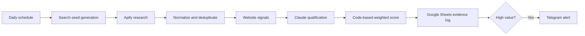

# Lead Intelligence Pipeline — Research, Qualification & Prioritization

**A 19-node AI-assisted B2B research workflow that finds candidate businesses, enriches public signals and produces a ranked shortlist for human review.**

**Type:** open-source pipeline prototype · **Stack:** n8n, Apify, Claude API, JavaScript, Google Sheets, Telegram.

## The business problem

Finding prospects is not the same as finding *relevant* prospects. A useful sales workflow has to collect sourced information, avoid re-processing the same company, explain its ranking and give a marketer a reason to investigate rather than blindly contact everyone.

## Pipeline

The checked-in [`Lead_Intelligence.json`](Lead_Intelligence.json) includes **19 workflow nodes**, including error formatting, failure logging and a wait step for rate control. Configure your own service credentials before testing. The public source is a shareable template, not evidence that every scheduled execution has run successfully.

## A deliberate AI boundary

**The language model interprets signals; JavaScript computes the ranking.** A model can identify likely booking friction or operational gaps from available sources, but its free-form numerical judgments can vary. Keeping the final scoring function in ordinary code makes weighting visible, reproducible and testable. Model-generated assessments remain hypotheses until verified against the business.

## Additional engineering principles

- **Deduplicate early** to avoid repeated model calls and redundant prospect records.
- **Record provenance** so each item can be checked; do not describe a scraped business as a verified sales lead.
- **Limit API spend and rate pressure** through configurable collection scope and the four-second wait before website research.
- **Separate evidence from outreach.** This pipeline prepares research. It does not prove marketing consent, automatically send campaigns, or verify email ownership.
- **Keep errors visible.** Failure-stage recording is more useful than a silent empty spreadsheet.

## What the demonstration proves

It documents the orchestration design, transformation code, AI-assisted interpretation, deterministic score calculation and high-value handoff. It does **not** establish conversion uplift, verified contact rates, or a production-scale prospect database.

## Repository map

- [`Lead_Intelligence.json`](Lead_Intelligence.json) — n8n workflow export
- [`env.example`](env.example) — configuration reference
- [`SECURITY.md`](SECURITY.md) — security notes

## Reproduce safely

Use only permitted/public sources, review provider terms, replace every placeholder, test a few synthetic or authorized business records, and inspect each intermediate object. Do not commit scraped personal contact details, tokens or customer lists.

**Portfolio:** https://olawaleolaonipekun.vercel.app
