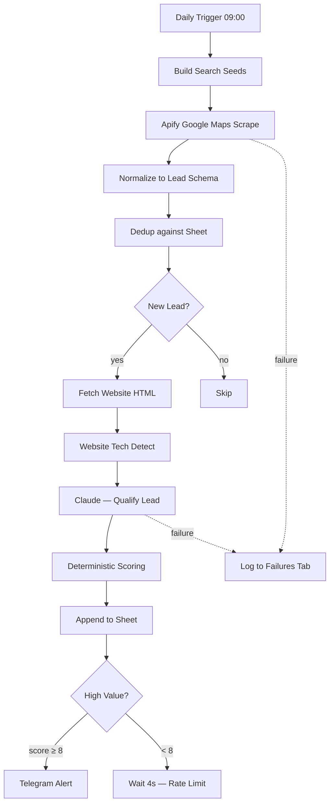

# Lead Intelligence Pipeline

> Daily-automated B2B lead discovery, qualification, and scoring. Built on n8n, Apify, and Anthropic Claude.

[](LICENSE)
[]()
[]()
[]()

A production-grade pipeline that runs every morning at 09:00, scrapes target businesses from Google Maps (and optionally Yelp), enriches each one with website tech detection, qualifies it through a structured LLM call, scores it deterministically in code, and alerts the operator only on the highest-fit leads.

Designed originally for finding US small businesses (restaurants, salons, medspas, home service providers) that would benefit from AI booking and receptionist automation — but the architecture is industry-agnostic. Change the seeds, change the prompt, change the scoring weights, and the same pipeline works for any B2B segment where Google Maps and a website are signal.

---

## Architecture



### What each stage does

| Stage | Node | Responsibility |
|---|---|---|
| 1 | Daily Trigger | Cron at 09:00 every morning |
| 2 | Set Config | Centralised configuration (sheet ID, model, thresholds, actor IDs) |
| 3 | Build Search Seeds | Rotates through category × city combinations to avoid hitting the same queries twice |
| 4 | Apify — Google Maps | Calls the canonical `compass/crawler-google-places` actor |
| 5 | Tag + Split Results | Adds source tags, splits the response into individual items |
| 6 | Normalize → Lead Schema | Maps Apify's response into a flat, predictable lead object |
| 7 | Dedup — Sheet Lookup | Checks Google Sheet to avoid re-processing leads we've already qualified |
| 8 | Fetch Website (best-effort) | Pulls the lead's homepage HTML if a URL is present |
| 9 | Website Tech Detect | Regex-based detection of existing booking tools (Calendly, Square, Booksy, Vagaro, Setmore, etc.) |
| 10 | Anthropic — Qualify Lead | Single Claude API call returning structured JSON (sub-scores, signals, suggested angle) |
| 11 | Score + Classify | **Deterministic** weighted scoring in code, not in the prompt |
| 12 | Append to Sheet | Persists the qualified lead with full enrichment |
| 13 | High-Value Alert | Telegram message to the operator for leads scoring ≥ 8 |
| 14 | Rate Limit | 4-second wait between leads to respect Claude rate limits |
| 15 | Failure Logging | All failures land in a separate sheet tab with stage, error code, and seed query |

---

## Why the scoring is in code, not in the prompt

This is the most important design decision in the workflow, so it's worth calling out.

LLMs drift on numerical scales. Ask Claude to score a lead "1 to 10" twice on the same input and you can get 7 and 8. Ask it across model versions and you get 6 and 9. That's fine for human readers — it's catastrophic for an outreach prioritisation system where you trust the top 10 every morning.

The fix: have the LLM emit **sub-signals** (booking friction, manual dependence, automation gap, activity), and compute the final score from those signals using a weighted formula in plain JavaScript. The LLM's job becomes recognising signals, not arithmetic. The code's job becomes consistent ranking.

```javascript
// excerpt from the Score + Classify node
const finalScore = (
  bookingFriction   * 0.30 +
  manualDependence  * 0.25 +
  automationGap     * 0.25 +
  activitySignal    * 0.20
);
```

Change a weight in code → all future leads re-rank consistently. Change the prompt → unpredictable.

---

## Tech stack

**Orchestration** &middot; n8n (self-hosted or cloud)
**Scraping** &middot; Apify (`compass/crawler-google-places` actor)
**LLM** &middot; Anthropic Claude Haiku (qualification — chosen for cost at production volume)
**Data** &middot; Google Sheets (leads + failures tabs)
**Alerts** &middot; Telegram Bot API
**Auth** &middot; n8n credential store for every external service (zero hardcoded keys)

---

## What's in this repo

```
lead-intelligence-pipeline/
├── README.md                       ← you are here
├── LICENSE                         ← MIT
├── SECURITY.md                     ← credential policy
├── .gitignore                      ← keeps secrets out
├── .env.example                    ← required environment variables
└── workflows/
    └── Lead_Intelligence.json      ← the complete n8n workflow
```

The workflow file is portable — every credential reference points to n8n's credential store, and configuration values like the Google Sheet ID and Telegram chat ID are placeholders in the `Set Config` node.

---

## Setup

### Prerequisites

You'll need accounts (free tiers fine for testing) with:

- A running [n8n](https://docs.n8n.io/hosting/) instance
- [Apify](https://apify.com) — for the Google Maps scraping
- [Anthropic](https://console.anthropic.com) — for the qualification call
- Google account — for Sheets storage
- Telegram bot — created via [@BotFather](https://t.me/BotFather)

### Steps

**1. Prepare the Google Sheet**

Create a new Google Sheet with two tabs:

- **`leads`** — columns: `place_id`, `name`, `address`, `city`, `state`, `phone`, `website`, `category`, `rating`, `reviews_count`, `detected_tools`, `score`, `tier`, `signals`, `suggested_angle`, `qualified_at`
- **`failures`** — columns: `timestamp`, `stage`, `error_code`, `error_message`, `seed_query`, `payload`

Copy the spreadsheet ID from the URL (the long string between `/d/` and `/edit`).

**2. Set up the Telegram bot**

Message [@BotFather](https://t.me/BotFather) → `/newbot` → follow prompts. Save the bot token.

Then start a chat with your new bot, send any message, and visit `https://api.telegram.org/bot<YOUR_TOKEN>/getUpdates` to get your chat ID.

**3. Import the workflow into n8n**

In n8n: **Workflows → Import from File** → select `workflows/Lead_Intelligence.json`.

After import, n8n will warn that credentials need to be reconnected. For each credential reference:

- **Apify** — create an `HTTP Header Auth` credential with `Authorization: Bearer <YOUR_APIFY_TOKEN>`
- **Anthropic** — create an `HTTP Header Auth` credential with `x-api-key: <YOUR_ANTHROPIC_KEY>` and `anthropic-version: 2023-06-01`
- **Google Sheets** — connect via OAuth2
- **Telegram** — paste your bot token

**4. Update the Set Config node**

Click into the `Set Config` node and replace:

- `REPLACE_WITH_YOUR_SHEET_ID` → your sheet ID from step 1
- `REPLACE_WITH_YOUR_CHAT_ID` → your Telegram chat ID from step 2

**5. Activate the workflow**

Toggle to **Active**. The cron will fire at 09:00 daily. To test immediately, click **Execute Workflow** in the editor.

---

## Tuning it for your market

The pipeline is built to be adapted, not used as-is. The two places to change:

**Seeds** — Edit the `Build Search Seeds` node. The format is `{category} in {city}`. Add or remove categories and cities to match your target market.

**Scoring weights** — Edit the `Score + Classify` node. Each weight is a factor in the final score. Push the weights toward whichever signal matters most for your offering.

**Prompt** — Edit the `Anthropic — Qualify Lead` node. The current prompt is tuned for AI booking/receptionist offerings. For other verticals, rewrite the section that describes "the offering" while keeping the JSON structure intact.

---

## Production notes

A few things to know if you take this past localhost:

**Rate limits.** The 4-second wait after each lead respects Claude's per-minute limits comfortably. If you process more than 15 leads per minute, add token bucketing.

**Apify costs.** Google Maps scraping at the default `MAX_RESULTS_PER_QUERY: 40` runs around $0.001–0.003 per lead returned. Budget accordingly when scaling.

**Failure observability.** Every HTTP node has a continue-on-fail branch that writes to the `failures` tab. Check that tab daily. Silent failures are how lead pipelines rot.

**Deduplication.** The sheet lookup is O(n) — fine for the first few thousand leads. Past 10,000 rows, move dedup to a proper database (Supabase, Postgres) with an index on `place_id`.

---

## Security

This repository contains **no live credentials**. Every secret reference in the workflow JSON points to n8n's credential store. See [SECURITY.md](SECURITY.md) for the full policy.

---

## License

[MIT](LICENSE) — use this however you like, including commercially.

---

## About

Built by **Olawale Emmanuel Olaonipekun**.

- Portfolio: [olawaleemmanuel09.github.io](https://olawaleemmanuel09.github.io)
- LinkedIn: [olawale-olaonipekun](https://www.linkedin.com/in/olawale-olaonipekun-0505303b4)
- X: [@LaoniAI](https://x.com/LaoniAI)

If you're building lead infrastructure and want to talk, the contact details on the portfolio work.
